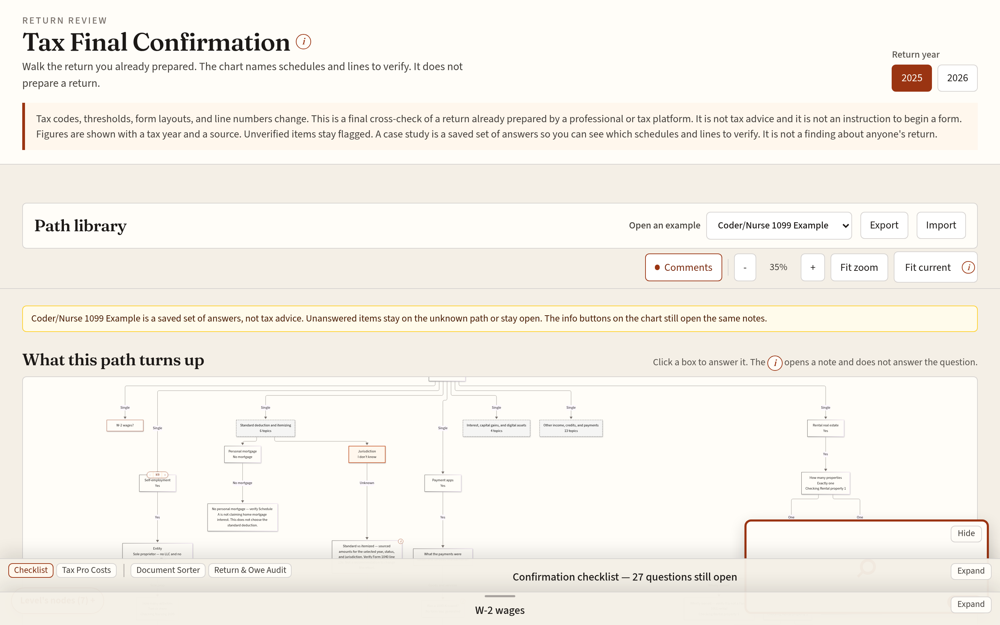
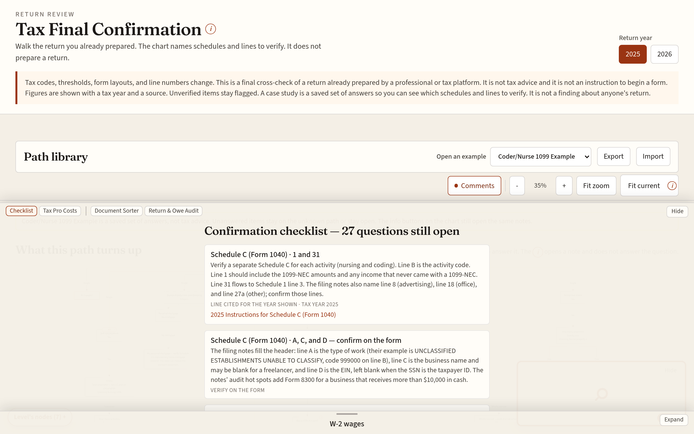
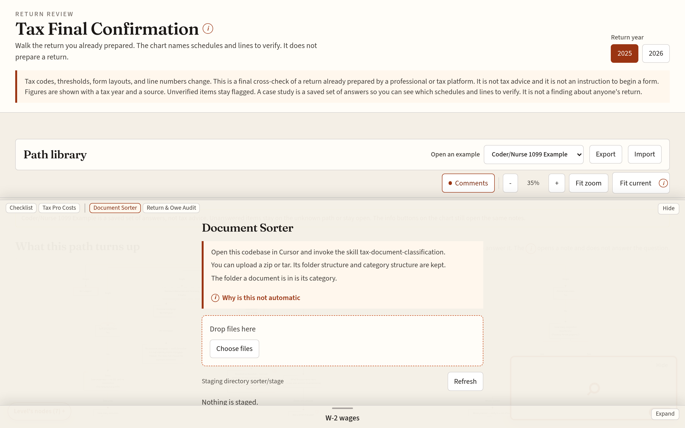
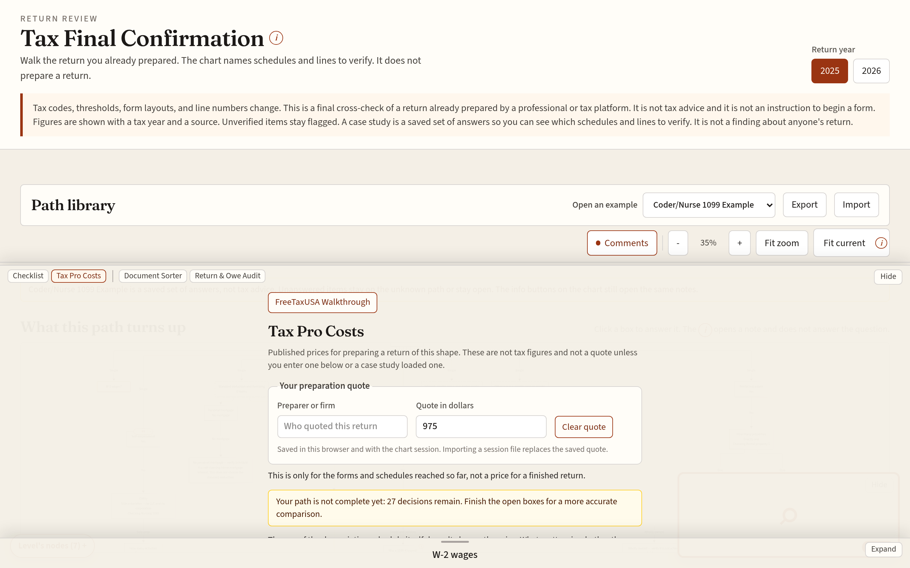

# Tax Final Confirmation

By Weng (Weng Fei Fung).


<a target="_blank" href="https://github.com/Siphon880gh" rel="nofollow"></a>
<a target="_blank" href="https://www.linkedin.com/in/weng-fung/" rel="nofollow"></a>
<a target="_blank" href="https://www.youtube.com/@WengTeachesCode/" rel="nofollow"></a>

You finished a return in a DIY tax service such as [FreeTaxUSA](https://www.freetaxusa.com), and you want a second pass before you file. This app walks the return you already prepared and recommends the schedules and forms to double-check, so you can confirm the software landed on the right ones.

The chart asks what is on that return and names the forms, schedules, and lines to verify. It does not prepare a return. Tax codes, thresholds, form layouts, and line numbers change. This is a cross-check, not tax advice. Figures are shown with a tax year and a source. Unverified items stay flagged. A case study is a saved set of answers so you can see which schedules and lines to verify. It is not a finding about anyone's return.

The decision graph, the on-screen chart, and the checklist all come from `src/lib/graph`. Read [docs/DECISION_GRAPH.md](docs/DECISION_GRAPH.md) for the full branching design, the sourced deduction amounts, the 2025 Form 1099-K threshold, and the preparation-price comparison.





## The guided flow

The bottom panel's tabs follow one flow. **Start here** opens first and shows where each step stands.

| Tab | Step or lead | What it is for |
| --- | --- | --- |
| Start here | Overview | How many documents are staged, whether `Summaries.md` and `Owed Audit.md` exist, and checklist progress. |
| 1 Document Sorter | Step 1 | Upload your documents and sort them into folders in `sorter/stage`. Every route reads them from there. |
| 2a Tax Pro Costs | Hand it to a pro: | Give the preparer `Summaries.md` (the `tax-document-summaries` skill writes it), then judge their quote against typical fees. |
| 2b Return & Owe Audit | AI calculate now: | The `tax-return-owed-audit` skill checks the return's amount owed against your documents. The tab stays grayed out until `Owed Audit.md` exists. |
| 2c Checklist | Guide me on forms: | The forms and lines your answers call for. It works any time, even with no documents. |

Pick one route after step 1; each route tab has a short lead in front of it (Hand it to a pro:, AI calculate now:, Guide me on forms:). The chart above the panel is the guided path. It asks one question at a time, starting with Filing status, and each answer adds forms and lines to the Checklist and Tax Pro Costs. **✦ Add / edit with AI** and **Hide** sit apart on the right because they are tools, not steps.

## Run it

```bash
npm install
npm run dev
```

Then open http://127.0.0.1:43123

Start blank, or open a case study. **Coder/Nurse 1099 Example** walks a single filer with two 1099-NEC activities, payment-app goods and services, and one paid-off rental. Louisiana versus Los Angeles, the payment-app amount, and whether the depreciation records are clean stay unknown. **Joint W-2 & Crypto Example** is a second, shorter path so the tool is not only that example. Case-study facts are not tax advice.

Your answers, named businesses and rentals, comments, the preparation quote, and which checklist items you ticked as confirmed save in this browser as you go, so a reload picks up where you left off. **Export** downloads the same state as a JSON file (with the confirmations) that **Import** reads back. **Start over** clears what this browser saved, after a confirm.

The **Checklist** tab shows how many items you have confirmed on the return, and can **Download .md** or **Print** a clean copy for your records or a preparer. When the path calls for source documents (a W-2, a 1099-NEC, rental records, a 1095-A, …), it also says how many of them the Document Sorter found in `sorter/stage`.

`npm test` runs these suites: the decision-graph tests (paths, checklist items, and the sourced 2025 and 2026 figures), the sorter-endpoint tests (which hosts get the local-only message), the browser-storage tests (saved session, checklist confirmations), the document-coverage tests, and the PHP sorter test, which starts `php -S` against `sorter/api.php` and is skipped when `php` is not installed. `npm run generate-graph` rewrites the decision-graph document from the same source.

The Tax year selector (header buttons, and a dropdown in the sticky Path library) offers 2025 and 2026, the two years with figures loaded and sourced. A blank chart starts on 2026; switching keeps your other answers, and the year is saved in the browser and in Export and Import. The standard deduction, age and blindness add-on, SALT cap, Social Security wage base, QBI thresholds, worker-reporting threshold, state standard deductions, and the checklist's line numbers all follow the selected year. 2025 lines come from the final IRS forms; 2026 lines come from the IRS early-release drafts (Schedule 1-A is renumbered and Form 1040 lines 13a and 13b swap), so they stay marked to verify until the final forms are out. Figures were last rechecked against the IRS, SSA, Louisiana LDR, and California FTB pages on November 25, 2026. Figures that could not be checked stay marked to verify.

## Deploy

The site is a hybrid: a static build plus one PHP endpoint, served side by side from the same PHP host.

- `npm run build` writes the static app to `out/`. The build rewrites asset paths to the page's own `.../out/` folder at runtime, so the same `out/` works wherever it is served (MAMP on localhost or the web host) and no folder path is baked into it. It also copies `public/sorter/` into `out/sorter/`, so `out/sorter/api.php` ships with the build, as before.
- `sorter/api.php` is the document sorter's endpoint. It reads and writes `sorter/stage/` beside itself and answers only the app (see **api.php answers only the app** below).

On the web host the layout is:

```
<host>/app/taxes/index.html         redirects to out/ (optional)
<host>/app/taxes/out/               the static build
<host>/app/taxes/sorter/api.php     the endpoint the Document Sorter and Return & Owe Audit tabs call
<host>/app/taxes/sorter/stage/      the staged documents api.php lists, places, and removes
```

The tabs find the endpoint in the browser (`src/lib/sorter-endpoint.ts`): `SERVER_URL_UPLOAD_API_PHP` from `.env` if it is set and reachable from the page, otherwise `sorter/api.php` next to the `out/` folder the page was served from. So on `https://wengindustries.com/app/taxes/out/` they call `https://wengindustries.com/app/taxes/sorter/api.php`, and a localhost URL in `.env` is used only on this computer. Keep `sorter/api.php` and `public/sorter/api.php` identical.

There is no deploy script in this repo. After `npm run build`, upload into `<host>/app/taxes/`:

| Upload | Why |
|---|---|
| `out/` (all of it, including `out/sorter/vendor/`, `out/sorter/.htaccess`, and `out/sorter/stage/.htaccess`) | The static app; `out/sorter/vendor/` is the PDF reader `sorter/api.php` loads from `../out/sorter/vendor` |
| `sorter/api.php` | The endpoint the tabs call |
| `sorter/app-config.php` | The allowed origins |
| `sorter/.htaccess` and `sorter/stage/.htaccess` | Block direct access to the sorter and turn PHP off in `stage/` |
| `.htaccess` (app root) | Blocks dotfiles, source folders, and everything under `sorter/` except `api.php` |
| `index.html` (optional) | Redirects `<host>/app/taxes/` to `out/` |
| `.env` (optional) | Only for Ask AI with your own `OPENAI_API_KEY` or `ANTHROPIC_API_KEY` |

Do not upload `sorter/.app-secret.php` (the server makes its own on first use), `sorter/stage/` documents you do not want on the host, `public/`, `src/`, `node_modules/`, `composer.json`, or `composer.lock`. On nginx, `.htaccess` does nothing; use [docs/NGINX.md](docs/NGINX.md) instead.

**Direct access is blocked, api.php stays open.** The `.htaccess` files deny direct HTTP fetches of everything except `out/` and `api.php`: `sorter/stage/` and any other folder under `sorter/` (documents, `Summaries.md`, `Owed Audit.md`, `Owe Audit Breakdown - Rent.md`), the same under `out/sorter/`, dotfiles such as `.env*` and `.git/`, and `context/`, `.agents/`, `scripts/`, `src/`, `tests/`, `docs/`, `node_modules/`. They use Apache 2.4 syntax with a 2.2 fallback:

- [`.htaccess`](.htaccess) at the app root
- [`sorter/.htaccess`](sorter/.htaccess), copied to `out/sorter/.htaccess` from [`public/sorter/.htaccess`](public/sorter/.htaccess)
- [`sorter/stage/.htaccess`](sorter/stage/.htaccess), copied to `out/sorter/stage/.htaccess` from [`public/sorter/stage/.htaccess`](public/sorter/stage/.htaccess); it also turns PHP off in the stage folder

`.htaccess` governs HTTP only, so `api.php` still reads and writes `sorter/stage/` on disk.

**api.php answers only the app.** Every action, reads included, goes through a gate at the top of [`sorter/api.php`](sorter/api.php), and anything that fails it gets `403 {"ok":false,"error":"forbidden"}`:

1. The request's `Origin` (or, for a GET without one, the `Referer`'s origin) must be listed in [`sorter/app-config.php`](sorter/app-config.php): `https://wengindustries.com`, `https://www.wengindustries.com`, `http://localhost:8888`, `http://127.0.0.1:8888`, and the dev server on port 43123. CORS echoes only those origins, never `*`.
2. The `X-Taxes-App: 1` header is required, which forces a CORS preflight; preflights from other origins get 403.
3. `GET api.php?action=handshake` sets a signed session cookie (HMAC-SHA256 over issue time and a random nonce; HttpOnly, SameSite=Strict, Secure on https, path limited to the sorter folder, 12 hours). Every other action needs a valid, unexpired cookie.
4. POSTs (upload, place, remove) also need the CSRF token the handshake returns, in `X-Taxes-Csrf`.
5. Responses are `Cache-Control: no-store`.

The signing key is `sorter/.app-secret.php`, created with `random_bytes` the first time `api.php` runs. It is gitignored, denied by `.htaccess` and the nginx rules, and should not be uploaded: let the server make its own. Deleting it signs everyone out. The tabs use [`src/lib/sorter-client.ts`](src/lib/sorter-client.ts), which does the handshake once, sends the headers on every call, and retries once after a fresh handshake when a session has expired. To serve the app from another address, add it to `app-config.php` (and `public/sorter/app-config.php`, which ships as `out/sorter/app-config.php`).

**nginx ignores `.htaccess` entirely.** On an nginx host, paste the `location` blocks from [docs/NGINX.md](docs/NGINX.md) into the server block, above the existing `location ~ \.php$` block.

## Sort documents with the AI skills

Before you walk the chart, you can drop W-2s, 1099s, receipts, bills, and scans into the **Document Sorter** tab, or straight into `sorter/stage/`.

The tab uploads and places files through PHP. Copy [`.example.env`](.example.env) to `.env` and set `SERVER_URL_UPLOAD_API_PHP` to the URL where PHP serves [`sorter/api.php`](sorter/api.php). Restart `npm run dev` after changing `.env`. The value is inlined by `npm run dev`, and by `npm run build` unless it is a localhost URL (the built `out/` finds `../sorter/api.php` next to itself, so the build does not carry this computer's folder layout). A built `out/` on another host skips a localhost value and calls `../sorter/api.php` next to itself (see Deploy). Putting files directly in `sorter/stage/` does not need that endpoint.

An AI skill, `tax-document-classification`, then sorts them into folders such as Income - Self-employment, Income - Rental, Deductions, and _Last year's return, and it renames generic filenames so each pile is easier to think about and to match against the schedules the chart names.



Open this repo in Cursor and invoke `tax-document-classification` (optionally with a folder and `--tax-year`). Files stay on the machine. The skill lives at [`.agents/skills/tax-document-classification/SKILL.md`](.agents/skills/tax-document-classification/SKILL.md).

Once those folders exist and `sorter/stage/Summaries.md` is not there yet, the tab asks you to invoke `tax-document-summaries`. That skill writes `Summaries.md`: the numbers a tax professional needs at a glance (for example a rental income and deductions summary) and a first look at which forms apply. Files stay on the machine. The skill lives at [`.agents/skills/tax-document-summaries/SKILL.md`](.agents/skills/tax-document-summaries/SKILL.md).

The same tab can also place files into those categories by hand after upload. Staged files are grouped under their category folder, with a filter by name, form, or folder.

**Documents this path calls for.** The tab lists the source documents the chart's answers so far call for (for example a Form W-2 once W-2 wages are on the path, Form 1099-NEC for Schedule C, rental records for Schedule E, Form 1095-A for Form 8962) and marks each one on file when a staged document matches it. The rules live in [`src/lib/document-coverage.ts`](src/lib/document-coverage.ts).

**Reading inside PDFs.** `sorter/api.php` (POST `action=pdf-hints`, behind the same app-only checks) opens each staged PDF read-only with [smalot/pdfparser](https://github.com/smalot/pdfparser) 2.13.1 (pure PHP, LGPL-3.0), reads the first four pages, and returns only short form tags such as `W-2`, `1099-NEC`, `1099-B`, `1098`, or `1095-A`, never the text. A PDF whose text names a form counts by that form, so `scan-0001.pdf` can satisfy Form W-2. A PDF with no text layer (a scan or phone photo), or any other file type, falls back to folder and file names. Each card shows what was read, the filter matches it, and "Ask AI to reorganize" gets the same tags as `reads as: W-2` after each file in its plan input. Nothing in `sorter/stage` is moved or written; answers are cached by path, size, and modified time in the system temp folder.

The library is vendored with Composer into `public/sorter/vendor` (see the root `composer.json`, platform pinned to PHP 7.4), and the build copies it to `out/sorter/vendor`. Upload that folder with `out/`. `api.php` looks for it beside itself, then in `../public/sorter/vendor` and `../out/sorter/vendor`; without it the sorter keeps working and goes by names only. The `.htaccess` files and the nginx rules deny `vendor/` over HTTP like everything else in `sorter/`.

### Ask AI to reorganize

The tab's **Ask AI to reorganize** button asks `sorter/api.php` whether an AI key is set (`?action=ai-status`).

- **No key (the default).** The dialog warns that AI or billing is not set up in this app and names the uploads folder, for example `/Users/you/…/taxes/sorter/stage`. Open that folder in your own AI harness (Cursor, Claude Code, …), ask it to reorganize the tax documents, then press Refresh. The dialog has Copy buttons for the folder path, a `cd` command and an example prompt, and this browser can remember your own copy of the folder's path. [`sorter/stage/AGENTS.md`](sorter/stage/AGENTS.md) tells the harness which category folders the app expects; the app leaves it out of the document list.
- **With a key.** Put `OPENAI_API_KEY` (ChatGPT) or `ANTHROPIC_API_KEY` (Claude) in `.env`, optionally with `AI_PROVIDER` and `AI_MODEL` (see [`.example.env`](.example.env)). `api.php` reads `.env` beside it, in the app folder above it, or above `out/` for the deployed copy; the key stays on the server. `ai-plan` sends the file paths and folders (not the file contents) to the provider and returns a move plan limited to listed files and folders under `sorter/stage/`. You uncheck any move you don't want, and `ai-apply` moves the rest with the same code as a manual category change. Each plan carries a signed token that works once, for 30 minutes.

### Return & Owe Audit

The **I have my return - audit owed** skill ([`.agents/skills/tax-return-owed-audit/SKILL.md`](.agents/skills/tax-return-owed-audit/SKILL.md)) reads the federal and state returns in `sorter/stage` and writes `Owed Audit.md` next to the source documents. When the return has rental income it also writes `Owe Audit Breakdown - Rent.md` in the same folder: how many dollars of the federal tax come from the rent, from recomputing the return with and without the Schedule E income.

The **Return & Owe Audit** tab is grayed out until one of those files exists, with the hint "No Owed Audit.md yet; run the I have my return - audit owed skill on sorter/stage, then refresh." The app checks again on load, when you come back to the window, when the Document Sorter refreshes, and when you press the grayed-out tab. Once a report is there, the tab opens `Owed Audit.md` in a reader and shows `Owe Audit Breakdown - Rent.md`, table included, right in the panel. `api.php` opens only files with those two exact names, and the Document Sorter, Ask AI to reorganize, and the sorting and summary skills leave both where the skill wrote them.

## Fill FreeTaxUSA from those files

Tax Pro Costs starts with a **FreeTaxUSA Walkthrough** control. After the files are sorted, open this repo in Cursor and invoke `freetaxusa-walkthrough`. The skill opens [FreeTaxUSA](https://www.freetaxusa.com) in a browser tab inside Cursor, reads the screen, and tells you the next entry with the number and the file it came from. It asks when that step is done, or watches the screen for the change. You type. It does not file the return. The skill lives at [`.agents/skills/freetaxusa-walkthrough/SKILL.md`](.agents/skills/freetaxusa-walkthrough/SKILL.md).

The same tab lists published preparation prices for the forms reached so far. FreeTaxUSA's pricing page retrieved October 16, 2026 lists federal filing at $0 and a state return at $15.99. Optional Deluxe Support, Pro Support, and Audit Defense are on that page and are not added to the estimate. H&R Block's online filing page, rendered in a browser October 21, 2026, lists Free Online $0 + $0 per state, Deluxe $65 + $49, Premium $105 + $49, and Self-Employed $130 + $49; the row picks the tier from the forms reached.

With a quote entered, the tab also says how much more it is than filing yourself on FreeTaxUSA ($0 federal + $15.99 for one state). The tab also shows an estimated independent-preparer fee, with a **How this estimate adds up** table of the base and each schedule add-on before and after inflation: NSA 2023 national averages raised by CPI-U inflation. The note says which month the inflation data runs through, and hints when newer data is likely out. To update the CPI-U figure by hand, see [`docs/UPDATE_INFLATION.md`](docs/UPDATE_INFLATION.md) (`npm run update-cpi -- --month YYYY-MM --value N --dry-run`).

When you ask which local skills this repo has, the answer comes from the folders under [`.agents/skills/`](.agents/skills/), as [AGENTS.md](AGENTS.md) describes.


